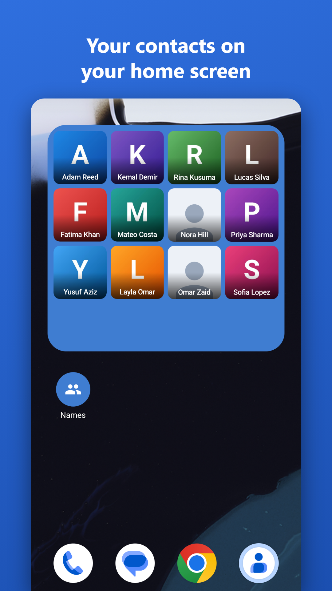
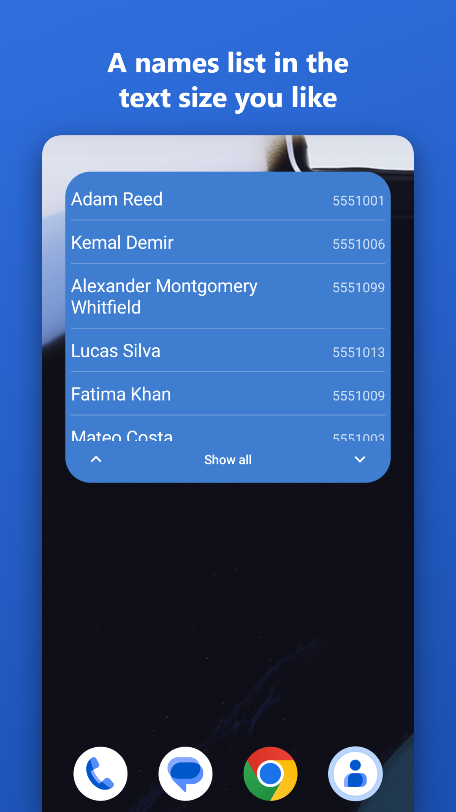
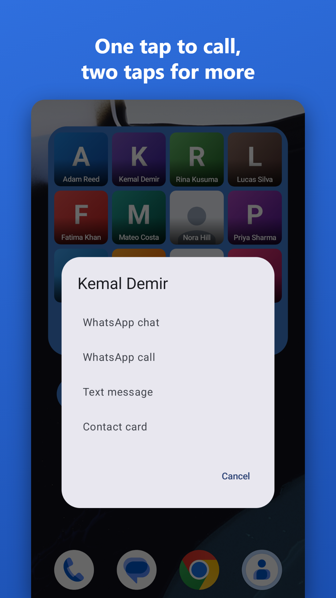

# Speed Contact | اتصال سريع

<div dir="rtl">

أدوات لشاشة أندرويد الرئيسية تضع الأشخاص الذين تتواصل معهم كثيراً أمامك، بالصور أو الأسماء، فتصل إليهم بضغطة واحدة دون فتح أي تطبيق.

</div>

Android home screen widgets that keep the people you talk to most in front of you, as photos or names, one tap away.

<p>
  
  
  
</p>

## الميزات

<div dir="rtl">

- **أربع أدوات:** شبكة صور، وقائمة أسماء، ومجلد صور، ومجلد قائمة أسماء.
- **الضغطة السريعة كما تختارها:** اتصال مباشر، أو محادثة واتساب، أو مكالمة واتساب، أو رسالة نصية، أو بطاقة الشخص. وتفتح بقية الخيارات بضغطتين على الشاشة الرئيسية، أو بالضغط المطول داخل المجلدات.
- **التخصيص:** أحجام الصور وأشكالها، والخلفيات، وحجم الخط، والرقم تحت الاسم أو بجانبه، وأيقونة المجلد من مجموعة جاهزة أو من معرض الصور.
- **ثماني لغات:** العربية والإنجليزية والأردية والهندية والإندونيسية والتركية والإسبانية والبرتغالية، مع خيار لتغيير اللغة داخل التطبيق في أندرويد 13 فأعلى.

</div>

## Privacy

The app has no internet permission, so your contacts stay on your phone. It has no accounts, ads or analytics.

Read the full [privacy policy](https://zahmee.github.io/SpeedContact/privacy-policy.html), available in all eight languages.

## Build

You need JDK 17 and the Android SDK. Android 8 (API 26) or later runs the app.

```bash
./gradlew testDebugUnitTest
./gradlew assembleDebug
```

Release signing reads `keystore.properties`, and publishing reads `keystore/play-service-account.json`. Neither is in this repository, and a normal build needs neither.

## Repository layout

| Path | Contents |
| --- | --- |
| `app/` | The Android app, in Kotlin with Compose and plain `RemoteViews` widgets |
| `store/` | Store listing text and graphics, and the upload guide |
| `docs/` | The privacy policy page, served by GitHub Pages, and the publishing guide |
| `tools/` | Scripts that generate listing files and read Google Play's state |

## Contact

Developed by [CDIT](https://cdit.co). Questions and privacy reports: <a href="mailto:info@cdit.co">info@cdit.co</a>

## License

[MIT](LICENSE)
